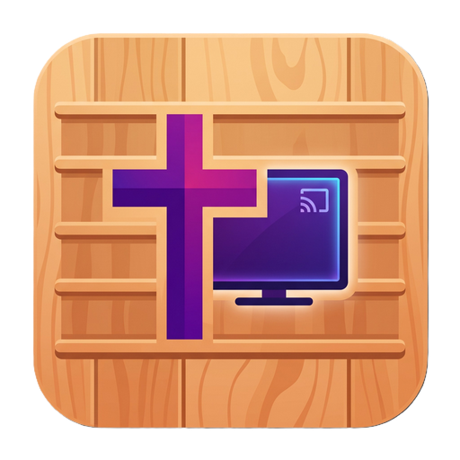
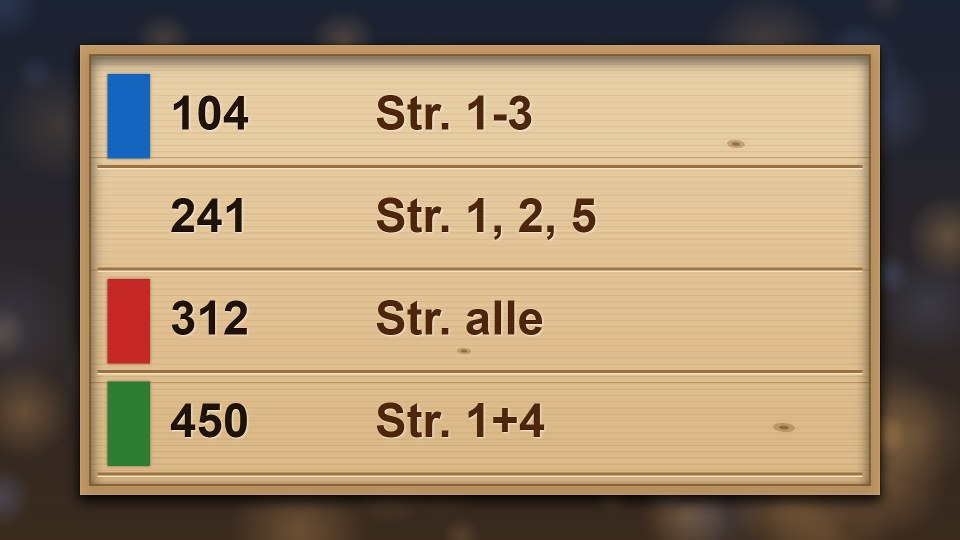
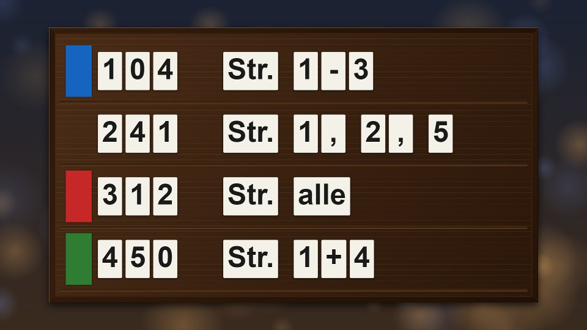
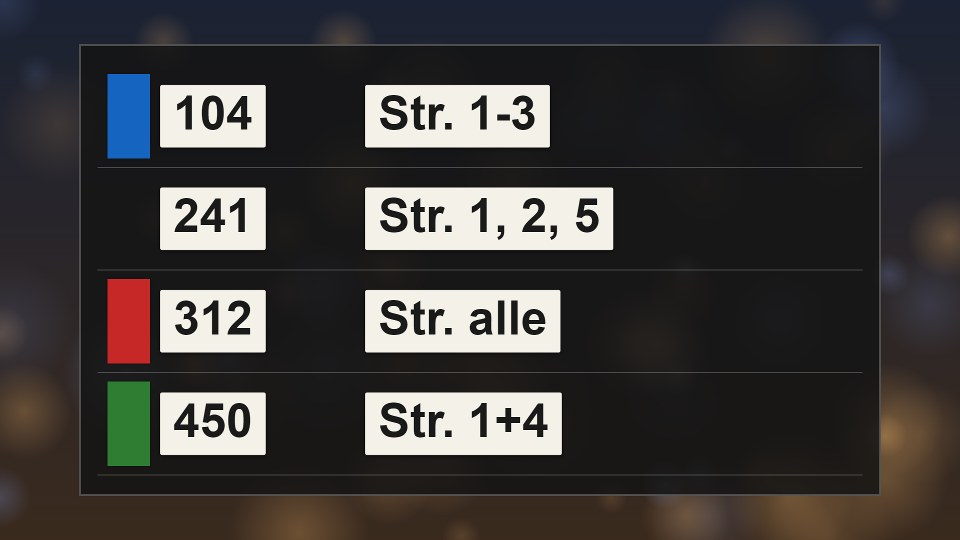
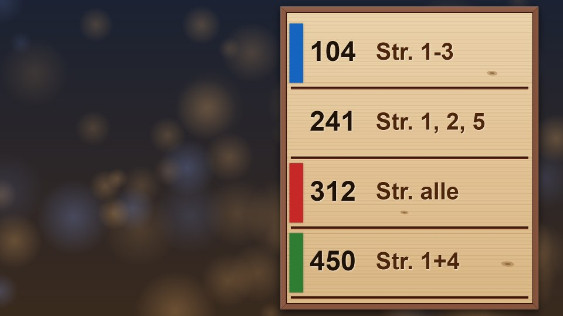
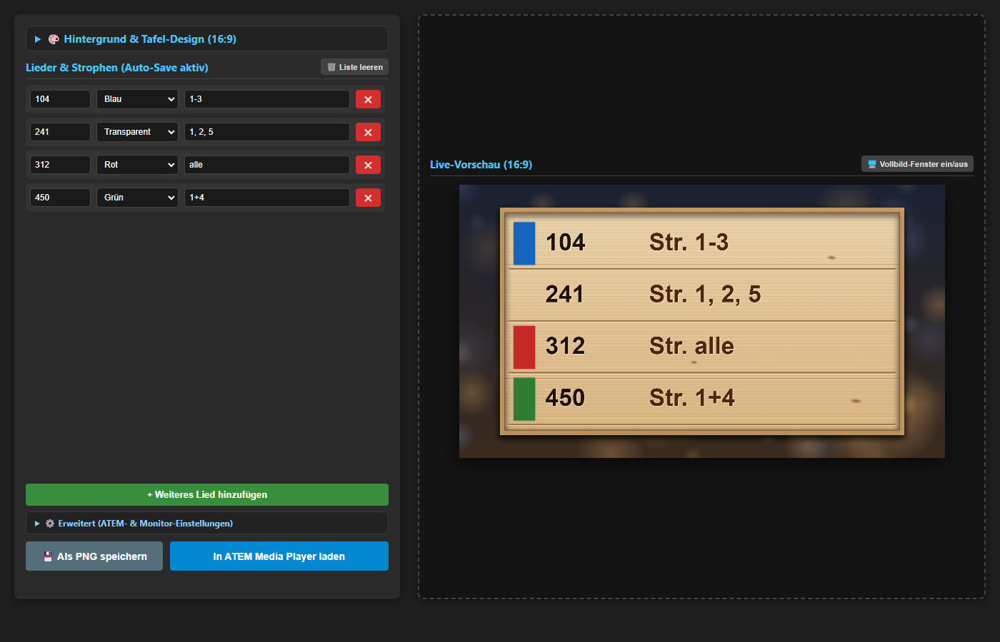
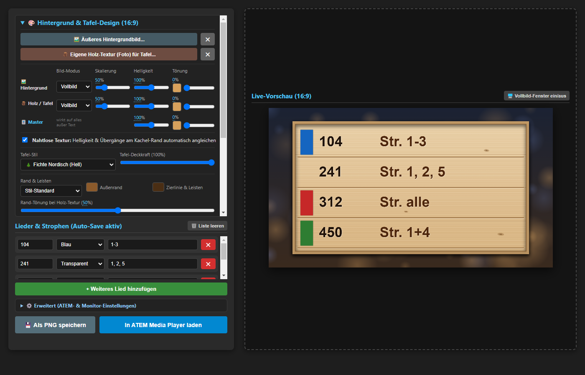
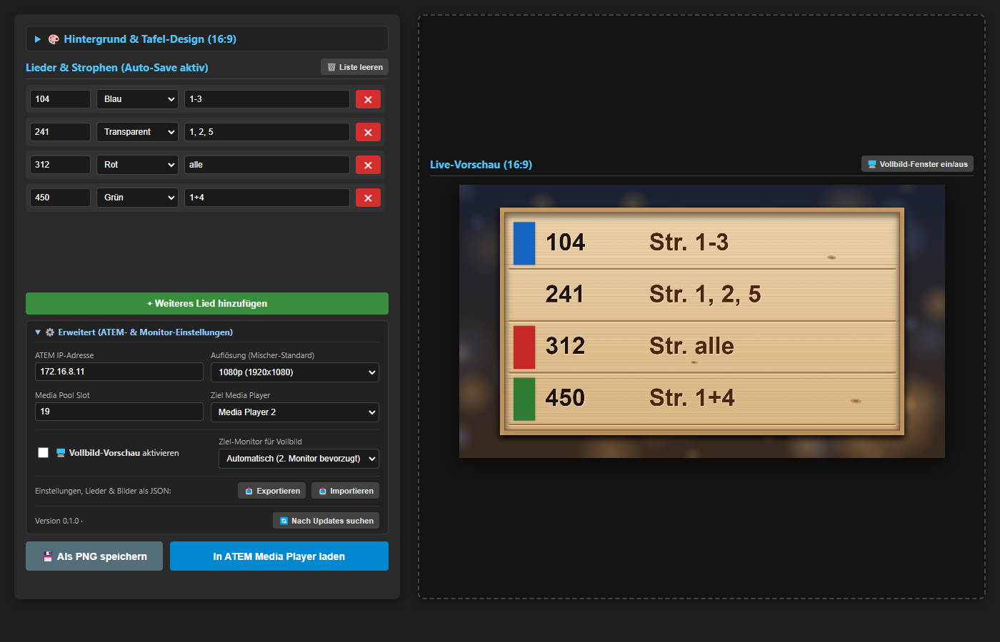

<p align="center">
  
</p>

<h1 align="center">Liedertafel</h1>

<p align="center">
  Digitale Liedtafel für Bildschirme im Gottesdienst – erzeugt aus Liednummern und Strophen
  ein fertiges Bild und spielt es direkt in einen Blackmagic ATEM Mischer oder auf einen TV.
</p>

---

## Wofür ist das Tool?

Viele Gemeinden haben einen Fernseher oder Monitor im Raum, der über einen Videomischer (z. B. Blackmagic ATEM) versorgt wird. Solange gerade nichts gezeigt wird, sieht man dort eine **große schwarze Fläche**. Das wirkt leer und zieht trotzdem den Blick auf sich.

Die **Liedertafel** macht aus dieser Fläche etwas Nützliches: Sie zeichnet eine **digitale Liedtafel** – wie die klassische Holztafel an der Kirchenwand – auf ein Hintergrundbild Eurer Wahl. Der Bildschirm fügt sich damit ruhig in den Raum ein, und gleichzeitig sieht jeder, welche Lieder und Strophen gesungen werden.

| Vorher: schwarzer Bildschirm | Nachher: Liedtafel auf Hintergrund |
|:---:|:---:|
|  |  |

Das fertige Bild lässt sich

- **direkt in den Media Pool eines ATEM-Mischers hochladen** (ein Klick),
- **als Vollbild auf einem zweiten Monitor/TV** anzeigen oder
- **als PNG-Datei speichern**, z. B. für Beamer-Software oder Präsentationen.

### Beispiele

| Helle Fichte (Standard) | Dunkle Eiche mit Ziffern-Karten |
|:---:|:---:|
|  |  |
| **Modern dunkel mit Einschub-Karten, leicht transparent** | **Schmale Tafel am rechten Rand, Holzrahmen eingefärbt** |
|  |  |

Größe, Seitenverhältnis und Position der Tafel sind frei einstellbar. So kann die Tafel genau den Platz füllen, der im Bild frei ist – zum Beispiel neben einem Kamerabild oder einem eingeblendeten Logo.

---

## Installation

Die fertigen Programme gibt es auf der Seite **[Releases](https://github.com/kai-schmid/LiveVeranstaltungMediengenerator/releases)**.

| System | Datei | Hinweis |
|---|---|---|
| Windows | `Liedertafel-…-windows-setup-x64.exe` | Installer mit Startmenü-Eintrag. Installationsordner ist wählbar. |
| Windows | `Liedertafel-…-windows-portable-x64.exe` | Ohne Installation, z. B. vom USB-Stick starten. |
| macOS | `Liedertafel-…-mac-arm64.dmg` / `…-x64.dmg` | arm64 für Apple-Silicon (M1 und neuer), x64 für Intel-Macs. |
| Linux | `.deb` / `.rpm` | Für Debian/Ubuntu bzw. Fedora/openSUSE. |

> **Hinweis zu Warnmeldungen:** Die Programme sind nicht mit einem kostenpflichtigen Zertifikat signiert.
> - **Windows** zeigt deshalb evtl. „Der Computer wurde durch Windows geschützt“ → *Weitere Informationen* → *Trotzdem ausführen*.
> - **macOS** meldet evtl., dass die App nicht geöffnet werden kann → im Finder **Rechtsklick auf die App → Öffnen** und bestätigen.

---

## Schnellstart

1. Liedtafel starten.
2. Unter **Lieder & Strophen** die Liednummern und Strophen eintragen.
3. Optional unter **🎨 Hintergrund & Tafel-Design** ein Hintergrundbild wählen und das Aussehen anpassen.
4. Unter **⚙️ Erweitert** einmalig die IP-Adresse des ATEM-Mischers eintragen.
5. **In ATEM Media Player laden** klicken – fertig.

Alle Eingaben werden automatisch gespeichert und sind beim nächsten Start wieder da.

---

## Die Oberfläche



- **Links** stehen alle Einstellungen. Die Bereiche *Hintergrund & Tafel-Design* und *Erweitert* lassen sich auf- und zuklappen; die App merkt sich, was offen war.
- **Rechts** zeigt die **Live-Vorschau** genau das Bild, das später ausgegeben wird. Jede Änderung ist sofort sichtbar.

> **Tipp:** Bei vielen Reglern ist der angezeigte Prozentwert unterstrichen. Ein **Klick auf die Zahl** öffnet ein Eingabefeld für einen genauen Wert (auch mit Komma).

### Lieder & Strophen

Jede Zeile ist ein Lied auf der Tafel:

| Feld | Bedeutung |
|---|---|
| **Nr.** | Liednummer, z. B. `324` oder auch `EG 324`. Zeilen **ohne Nummer werden nicht angezeigt** – so kann man Zeilen vorbereiten, ohne dass sie sichtbar sind. |
| **Farbe** | Farbiger Markierungsbalken links neben der Nummer (Blau, Rot, Grün, Gelb, Lila, Weiß, Schwarz oder Transparent = kein Balken). Praktisch z. B. für verschiedene Liederbücher. |
| **Strophen** | Freier Text, z. B. `1-3`, `1, 2, 5`, `alle`. Leer lassen, wenn keine Strophen angezeigt werden sollen. |
| **✕** | Entfernt die Zeile. |

- **+ Weiteres Lied hinzufügen** hängt eine neue Zeile an.
- **🗑️ Liste leeren** setzt die Liste auf vier leere Zeilen zurück.
- Die Tafel ist immer in **mindestens vier Zeilen** eingeteilt. Bei mehr Liedern werden die Zeilen entsprechend schmaler.
- Die Liste wird bei jeder Eingabe automatisch gespeichert (*Auto-Save*).

### 🎨 Hintergrund & Tafel-Design



#### Bilder

| Schaltfläche | Funktion |
|---|---|
| **🖼️ Äußeres Hintergrundbild…** | Bild, das hinter der Tafel den ganzen Bildschirm füllt (z. B. ein Foto des Kirchraums, ein Fenster, eine ruhige Textur). |
| **🪵 Eigene Holz-Textur (Foto) für Tafel…** | Eigenes Foto als Oberfläche der Tafel – z. B. ein Foto der echten Holztafel aus Eurer Kirche. Ohne Foto wird eine eingebaute Holzmaserung gezeichnet. |
| **✕** | Entfernt das jeweilige Bild wieder. |

#### Ebenen: Hintergrund, Holz/Tafel und Master

Für **Hintergrund** und **Holz/Tafel** gibt es jeweils dieselben Regler:

| Regler | Funktion |
|---|---|
| **Bild-Modus** | *Kacheln*: Das Bild wird wiederholt (gut für Texturen). *Vollbild*: Das Bild wird einmal groß über die ganze Fläche gelegt (gut für Fotos). |
| **Skalierung** | Größe der Kacheln bzw. Zoom des Vollbilds. |
| **Helligkeit** | Abdunkeln (unter 100 %) oder Aufhellen (über 100 %). Ein etwas dunklerer Hintergrund lässt die Tafel stärker hervortreten. |
| **Tönung** | Farbe und Stärke einer Einfärbung, z. B. um ein Foto wärmer oder kühler wirken zu lassen. |

Die Zeile **🎚️ Master** wirkt mit Helligkeit und Tönung auf **alles außer der Schrift** – Hintergrund, Tafel, Rahmen und Leisten zusammen. Damit lässt sich das ganze Bild schnell an die Helligkeit im Raum anpassen, ohne dass die Schrift schlechter lesbar wird.

**Nahtlose Textur:** Gleicht beim Kacheln Helligkeit und Übergänge an den Kachelrändern an, damit keine harten Kanten sichtbar sind.

#### Tafel

| Einstellung | Funktion |
|---|---|
| **Tafel-Stil** | 🌲 *Fichte Nordisch (hell)* mit dunkler Schrift, 🪵 *Dunkle Eiche / Nussbaum* mit heller Schrift oder ⬛ *Modern dunkel* ohne Holz. |
| **Tafel-Deckkraft** | Macht die Tafel durchscheinend, sodass der Hintergrund durchschimmert. Bei 0 % wird nur die Schrift gezeichnet. |
| **Rand & Leisten** | Aussehen von Rahmen und Einschubleisten zwischen den Zeilen (siehe unten). |
| **Tafel-Größe** | Vergrößert/verkleinert die ganze Tafel. Das Seitenverhältnis bleibt dabei erhalten. |
| **Breite / Höhe** | Ändern Breite und Höhe getrennt und damit das **Seitenverhältnis** (z. B. eine schmale, hohe Tafel für den Bildrand). Daneben wird das aktuelle Verhältnis angezeigt; **↺ 16:9** setzt beides zurück. Bei niedriger Tafel wird die Schrift automatisch verkleinert, damit sie in die Zeilen passt. |
| **Pos. X / Pos. Y** | Position der Tafel im Bild (0 % = links/oben, 50 % = Mitte, 100 % = rechts/unten). |
| **Strophen** | Schriftgröße der Strophen-Angabe. |
| **Präfix „Str.“** | Schreibt `Str.` vor die Strophen. Ohne Haken erscheinen nur die eingetragenen Zahlen/Texte. |

**Rand & Leisten** bietet vier Varianten:

| Variante | Ergebnis |
|---|---|
| **Stil-Standard** | Passende Farben zum gewählten Tafel-Stil. |
| **Eigene Farben** | *Außenrand* und *Zierlinie & Leisten* frei wählbar. |
| **Aus Holzfarbe (auto)** | Farben werden automatisch aus der (getönten) Holzfarbe der Tafel abgeleitet. |
| **Holz-Textur** | Der Rahmen besteht aus der Holz-Textur – wie ein echter Holzrahmen aus vier Leisten mit schrägen Ecken. Die Fasern laufen immer **der Länge nach** entlang der Leiste, auch wenn das Foto eine senkrechte Maserung hat. Mit der Farbe *Außenrand* und dem Regler **Rand-Tönung** lässt sich der Rahmen einfärben, ohne dass die Maserung verloren geht. |

#### Schrift & Einschub-Karten

| Einstellung | Funktion |
|---|---|
| **Text-Darstellung** | ✏️ *Direkt auf der Tafel*, 🃏 *Einschub-Karten (ganze Nummer)* oder 🔢 *Einschub-Karten (je Ziffer)* – wie die einzelnen Zahlenkarten einer klassischen Liedtafel. |
| **Kartenfarbe** | Farbe der Einschub-Karten. |
| **Kartenhöhe** | Höhe der Karten im Verhältnis zur Zeile. |
| **Ziffern-Abstand** | Abstand zwischen den einzelnen Ziffern-Karten. |
| **Eigene Schriftfarbe** | Eigene Farben für Liednummer und Strophen. Ohne Haken wählt die App automatisch eine gut lesbare Farbe passend zur Tafel. |

### ⚙️ Erweitert (ATEM- & Monitor-Einstellungen)



| Einstellung | Funktion |
|---|---|
| **ATEM IP-Adresse** | Netzwerkadresse des Mischers (zu finden in *ATEM Setup* bzw. *ATEM Software Control*). Der Computer muss im selben Netzwerk sein. |
| **Auflösung** | Größe des erzeugten Bildes: 1080p (1920×1080) oder 720p (1280×720). Muss zum Videoformat des Mischers passen. |
| **Media Pool Slot** | Speicherplatz im Media Pool des ATEM (1–40), in den das Bild geladen wird. **Ein dort vorhandenes Bild wird überschrieben.** |
| **Ziel Media Player** | Media Player, dem das Bild nach dem Hochladen zugewiesen wird. |
| **Vollbild-Vorschau aktivieren** | Öffnet ein randloses Vollbild-Fenster mit der Tafel (siehe unten). |
| **Ziel-Monitor für Vollbild** | Bildschirm für das Vollbild-Fenster. *Automatisch* nimmt bevorzugt den zweiten Monitor. Neu angesteckte Monitore/TVs erscheinen automatisch in der Liste. |
| **Exportieren / Importieren** | Sicherung aller Einstellungen (siehe [Export & Import](#export--import)). |
| **Nach Updates suchen** | Prüft, ob es eine neuere Version gibt (siehe [Updates](#updates)). |

---

## Ausgabe

### In ATEM Media Player laden

Ein Klick auf **In ATEM Media Player laden**

1. verbindet sich mit dem Mischer unter der eingetragenen IP-Adresse,
2. lädt das Bild in den gewählten **Media Pool Slot** und
3. weist es dem gewählten **Media Player** zu.

Unter den Schaltflächen steht, ob es geklappt hat. Ist der Mischer nach etwa 8 Sekunden nicht erreichbar, erscheint eine Fehlermeldung – dann IP-Adresse und Netzwerkverbindung prüfen.

### Als PNG speichern

Speichert die Tafel in der eingestellten Auflösung als Bilddatei `Liedertafel_JJJJ-MM-TT.png`, z. B. für Beamer-Software, Präsentationen oder als Vorlage.

### Vollbild-Fenster

Mit **🖥️ Vollbild-Fenster ein/aus** (über der Vorschau) oder dem Haken *Vollbild-Vorschau aktivieren* öffnet sich die Tafel als randloses Vollbild auf dem gewählten Monitor. Damit kann ein TV auch **ohne ATEM** direkt am Computer betrieben werden.

- Änderungen erscheinen sofort auch im Vollbild.
- Schließen mit **Esc**, **Doppelklick** oder erneutem Klick auf die Schaltfläche.
- War das Vollbild beim Beenden aktiv, öffnet es sich beim nächsten Start automatisch wieder.

---

## Export & Import

Unter **⚙️ Erweitert → Einstellungen, Lieder & Bilder als JSON** lässt sich der komplette Stand sichern und wiederherstellen.

### Exportieren

**📤 Exportieren** speichert eine Datei `Liedertafel-Einstellungen_JJJJ-MM-TT.json` mit:

| Inhalt | Enthalten |
|---|---|
| Alle Design-Einstellungen (Stil, Farben, Regler, Größe, Position, Schrift …) | ✔ |
| ATEM-Einstellungen (IP, Auflösung, Slot, Media Player) | ✔ |
| Liederliste mit Nummern, Farben und Strophen | ✔ |
| Hintergrundbild und Holz-Textur (direkt in der Datei eingebettet) | ✔ |
| Vollbild-Fenster an/aus und gewählter Monitor | ✘ – gehört zum jeweiligen Rechner |

Die Datei ist damit **in sich vollständig**: Sie kann auf einen anderen Computer kopiert werden, ohne die Bilder separat mitzunehmen.

### Importieren

**📥 Importieren** lädt eine solche Datei und übernimmt alles daraus sofort.

- Teile, die in der Datei fehlen, bleiben unverändert.
- Ältere Sicherungen funktionieren auch mit neueren Versionen der App. Neue Einstellungen erhalten dann ihren Standardwert.
- Die Datei wird vor dem Übernehmen geprüft. Ist sie keine Liedtafel-Sicherung, beschädigt oder stammt aus einer neueren App-Version, erscheint eine Fehlermeldung und **nichts** wird verändert.
- Sehr große Bilder können evtl. nicht dauerhaft gespeichert werden. Die App weist dann darauf hin; das Bild bleibt bis zum Beenden aktiv. In dem Fall ein kleineres Bild verwenden (ein paar MB reichen völlig).

### Wofür ist das nützlich?

- **Sicherung**, bevor man etwas ausprobiert.
- **Umzug** auf einen neuen Computer oder einen zweiten Rechner (z. B. Ersatzlaptop).
- **Vorlagen** für verschiedene Anlässe, z. B. *Gottesdienst*, *Weihnachten*, *Jugendgottesdienst* – jeweils mit eigenem Hintergrund und Design. Vor dem Gottesdienst die passende Datei importieren und nur noch die Lieder anpassen.
- **Weitergeben** eines gelungenen Designs an andere Gemeinden.

---

## Updates

Etwa drei Sekunden nach dem Start fragt die App bei GitHub nach, ob es eine neuere Version gibt. Wenn ja, erscheint unten rechts ein Hinweis:

| Schaltfläche | Funktion |
|---|---|
| **⬇️ Herunterladen** | Öffnet den Download der passenden Datei im Browser (Installer bzw. portable Version, je nachdem, was gerade läuft). |
| **Was ist neu?** | Zeigt die Änderungen der neuen Version. |
| **Später** | Blendet den Hinweis bis zum nächsten Start aus. |
| **Version überspringen** | Erinnert an diese Version nicht mehr – erst wieder an die nächste. |

Unter **⚙️ Erweitert** steht die installierte Version, und **🔄 Nach Updates suchen** prüft jederzeit von Hand. Installiert wird nichts automatisch. Ohne Internet startet die App ganz normal.

---

## Wo werden die Daten gespeichert?

Einstellungen, Liederliste und Bilder liegen lokal im Benutzerprofil des Computers. Es werden keine Daten an fremde Server geschickt – die einzige Verbindung ins Internet ist die Abfrage nach Updates bei GitHub. Zur Sicherung empfiehlt sich gelegentlich ein [Export](#exportieren).

---

## Für Entwickler

Die App ist mit [Electron](https://www.electronjs.org/) gebaut; der ATEM-Upload nutzt [atem-connection](https://github.com/nrkno/sofie-atem-connection).

```bash
npm install          # Abhängigkeiten installieren
npm start            # App im Entwicklungsmodus starten

npm run dist:win     # Windows: Installer + portable EXE  -> dist/
npm run dist:mac     # macOS: dmg (nur auf einem Mac)
npm run dist:linux   # Linux: deb + rpm
```

**Release veröffentlichen:** Einen Versions-Tag pushen – GitHub Actions baut dann alle Plattformen und hängt die Dateien an ein neues Release:

```bash
git tag v0.2.0
git push origin v0.2.0
```

Tags mit Bindestrich (z. B. `v1.0.0-beta.1`) werden als Pre-Release veröffentlicht und nicht als Update angeboten.

### Projektaufbau

```
main.js                      Hauptprozess: Fenster, IPC
src/main/                    ATEM-Upload, Monitore, Vollbild-Fenster, Update-Prüfung
src/renderer/index.html      Oberfläche
src/renderer/js/             Einstellungen, Liederliste, Bilder, Export/Import, Updates
src/renderer/js/render/      Zeichnen der Tafel (Hintergrund, Holz, Rahmen, Schrift)
src/preview/                 Vollbild-Fenster
src/icons/                   App-Icon
docs/screenshots/            Bilder für diese README
```

---

## Lizenz

[Apache License 2.0](LICENSE)
